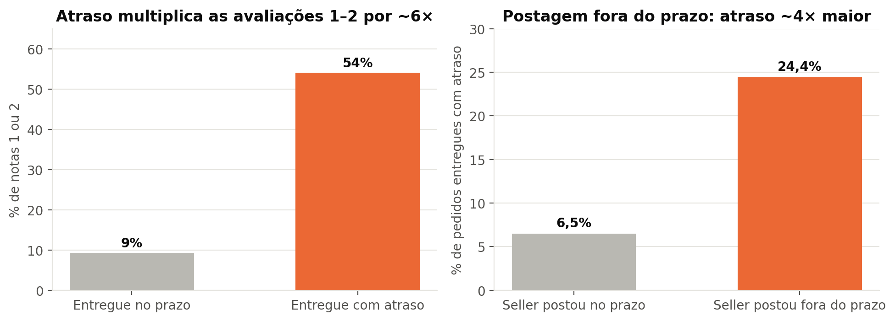
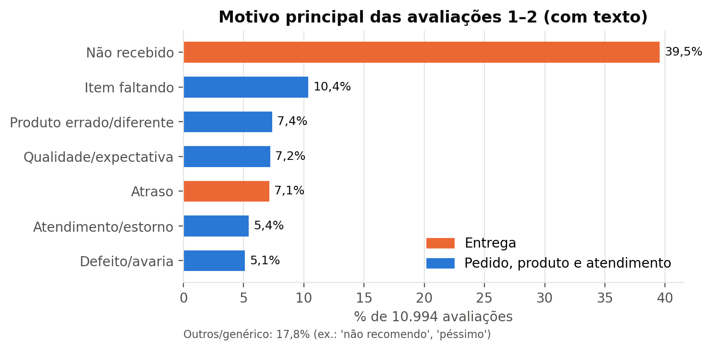
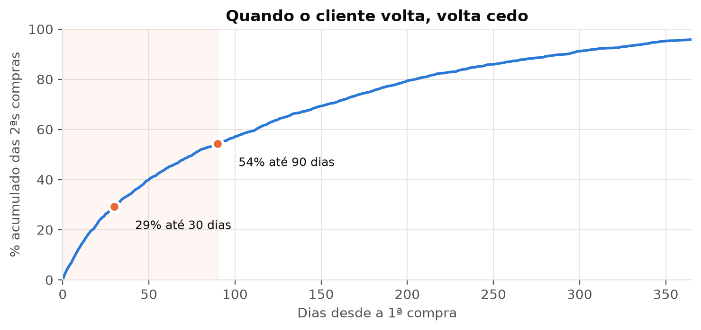
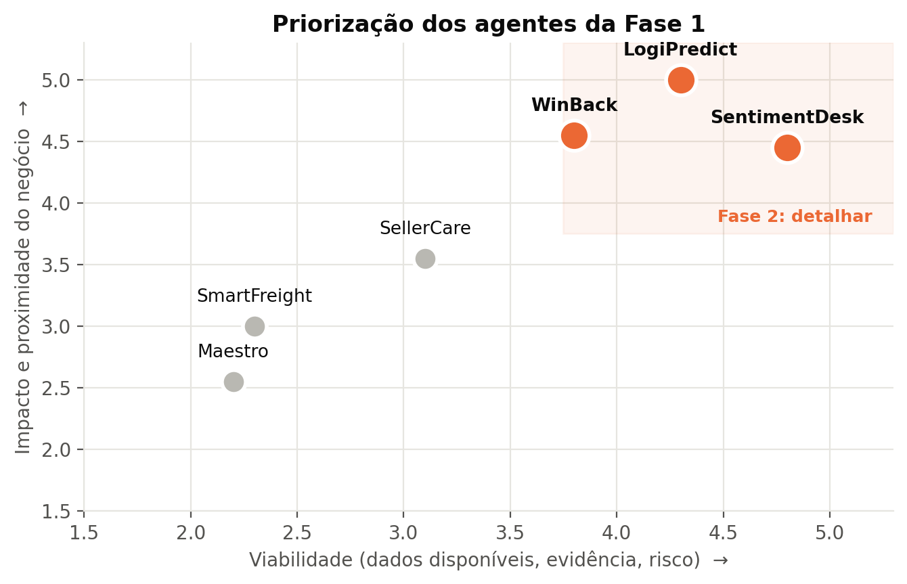
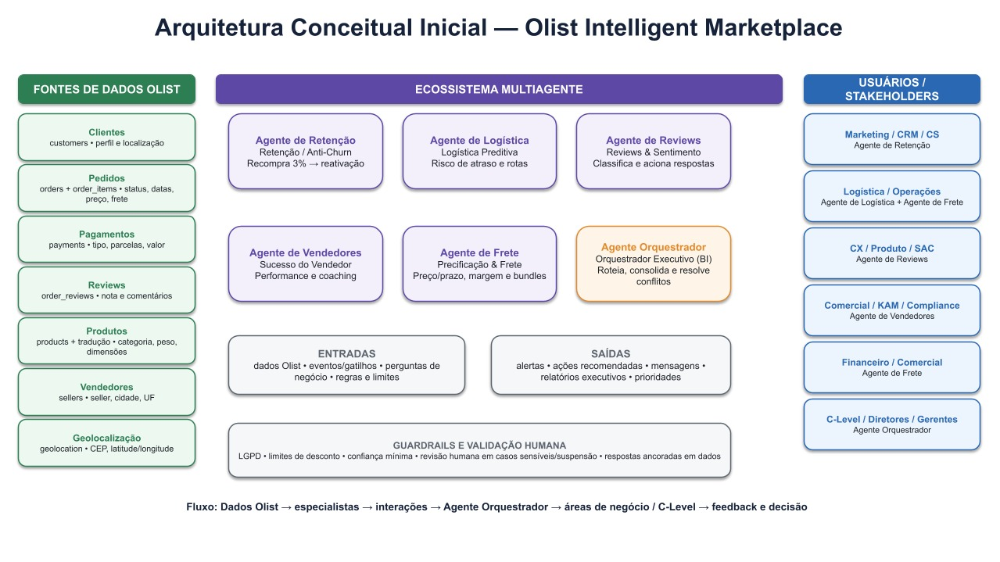
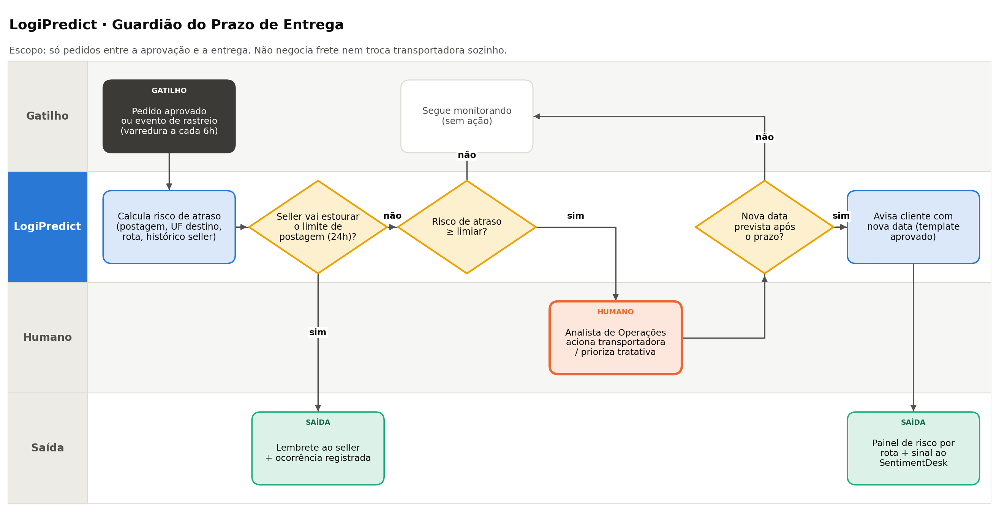
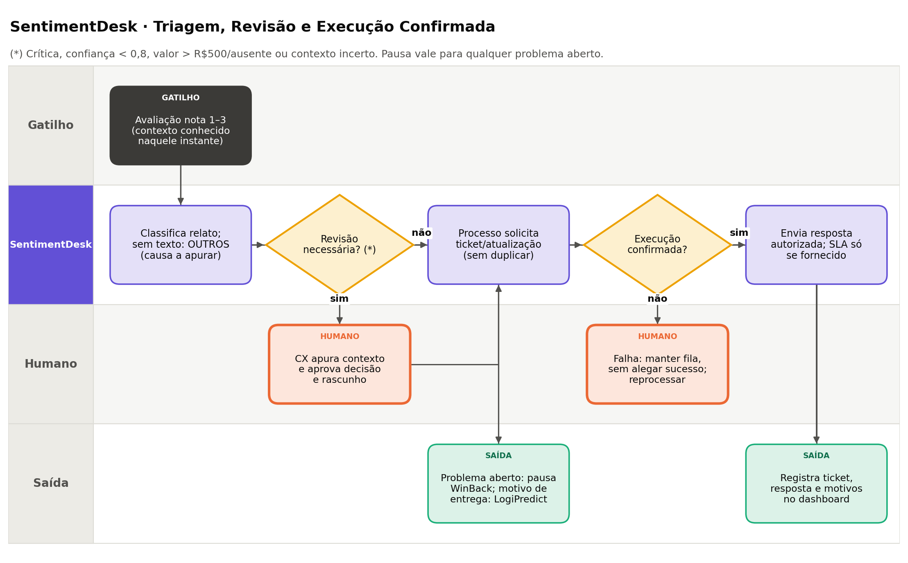
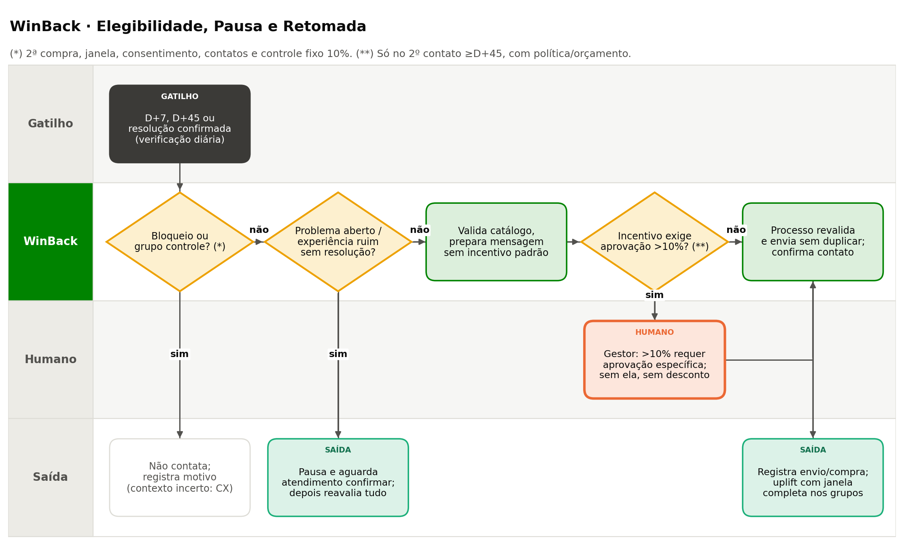
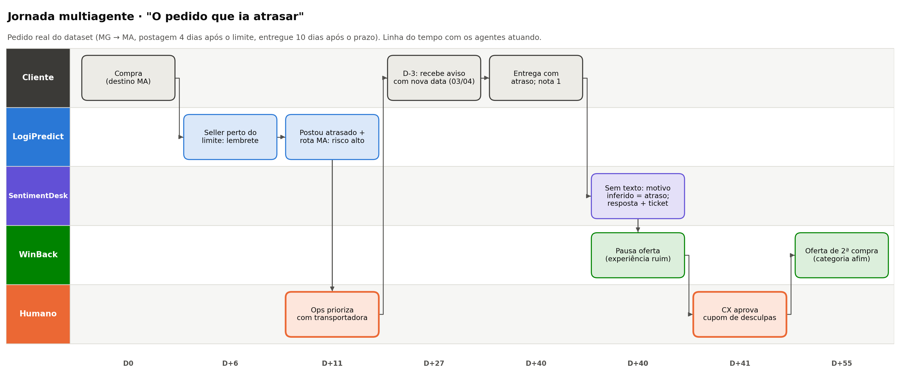

<!--
FONTE ÚNICA do Relatório Executivo — versão 2.0 (Fase 2).
É a EVOLUÇÃO do relatório entregue na Fase 1 (fase1/Relatorio_Executivo_Fase1_Olist_FINAL.pdf):
mesma estrutura de seções; conteúdo da Fase 1 mantido e corrigido; itens da Fase 2 inseridos.
Marcas nos títulos: "(atualizado na Fase 2)" e "(novo na Fase 2)".
Gerar .docx/.pdf:  python fase2/gerar_relatorio.py
Números: fase2/dados/numeros_fase2.json (notebook 08) e, para os números herdados da Fase 1, notebooks 01–07.
-->

# Histórico do Documento

| Versão | Data | Fase | Conteúdo |
|---|---|---|---|
| 1.0 | 26/08/2026 | Fase 1 · Identificar oportunidades | Diagnóstico do dataset, mapa de 6 agentes, arquitetura conceitual, prompts iniciais, riscos e roadmap |
| **2.0** | **27/10/2026** | **Fase 2 · Estruturar casos de uso e desenho dos agentes** | Este documento: Fase 1 revisada + priorização, casos de uso detalhados, jornadas, prompts v2 e business case |

**O que mudou da versão 1.0 para a 2.0**

| Aprendizado da avaliação da Fase 1 | Como a versão 2.0 responde | Onde |
|---|---|---|
| Detalhar o racional de onde partiram os achados | Cada achado ganhou uma **cadeia de evidência**: pergunta → tabela/coluna → método → resultado → decisão de desenho | Seção 4.5 |
| Ações dos agentes muito amplas | Cada agente priorizado tem **um objetivo**, **gatilhos definidos**, **lista fechada de ações** e um quadro do que **não faz** | Seções 8 a 10 |
| Muitos objetivos; priorizar o mais próximo do negócio | **Matriz de priorização** ponderada: dos 6 agentes, **3 detalhados**, todos na jornada do pedido | Seção 5.3 |
| Falha de revisão | Fonte única de números gerada por notebook, revisão de consistência e apêndice de rastreabilidade | Apêndice A |

**Correções em relação à versão 1.0:** tempo médio de entrega padronizado em **12,56 dias**, com trânsito de 9,33 dias e processamento de 3,23 dias (recalculados no notebook 08). O "tempo de resposta a reviews de 3,15 dias" foi reinterpretado: a coluna `review_answer_timestamp` registra quando o **cliente respondeu a pesquisa**, não quando a Olist respondeu. O roadmap, que tinha duas ordens diferentes na versão 1.0, foi unificado.

<!-- pagebreak -->

# 1. Sumário Executivo (atualizado na Fase 2)

A análise do dataset público da Olist revelou, na Fase 1, um marketplace com forte capacidade de aquisição e fricções relevantes em retenção, logística, experiência do cliente e gestão de sellers. A recompra é de apenas **3,00%**; **8,11%** dos pedidos chegam após o prazo; o frete representa **21,34%** do valor do pedido; e **14,7%** das avaliações são notas 1 ou 2.

Na Fase 2, a diretoria aprovou a continuidade e perguntou: **como os agentes vão interagir com usuários, dados e processos para gerar valor real?** A resposta parte de uma constatação: os problemas de experiência, reputação e recorrência **nascem no mesmo lugar, a jornada do pedido**. Quando o pedido atrasa, **54%** dos clientes dão nota 1 ou 2 (contra 9% no prazo). **27%** dos atrasos começam antes da transportadora, com o seller postando depois do limite. E quem teve a 1ª compra atrasada volta menos (1,56% contra 2,13%).

Por isso, **dos seis agentes propostos na Fase 1, três foram priorizados e detalhados**. Eles atuam em sequência na jornada do pedido:

| Desafio (Fase 1) | Evidência | Agente | Situação na Fase 2 | KPI principal |
|---|---|---|---|---|
| Atrasos logísticos | 8,11%; 27% começam na postagem | **LogiPredict** · Guardião do Prazo | **Detalhado** | Taxa de atraso |
| Insatisfação | 14,7% notas 1–2; 47% falam de entrega | **SentimentDesk** · Triagem de Avaliações Negativas | **Detalhado** | Tempo até a 1ª resposta |
| Baixa recorrência | Recompra 3,00%; 54% das 2ªs compras em até 90 dias | **WinBack** · Segunda Compra | **Detalhado** (reposicionado) | Conversão em 2ª compra |
| Qualidade de sellers | 527 no cluster problemático | SellerCare | Ações absorvidas por LogiPredict e SentimentDesk; Wave 3 | Nota / SLA |
| Peso do frete | 21,34% do pedido | SmartFreight | Backlog (falta dado de concorrência) | Frete / conversão |
| Decisão fragmentada | Sinais dispersos | Maestro | Orquestração na Fase 4 | Tempo para decisão |

**Valor esperado no cenário base (12 meses, escala do dataset):** 670 atrasos evitados e cerca de 300 avaliações 1–2 a menos (LogiPredict); 1.229 horas de triagem poupadas, ou R$ 55 mil (SentimentDesk); 358 segundas compras adicionais, ou R$ 53 mil de receita (WinBack).

**Recomendação:** aprovar um **piloto de 90 dias da Wave 1 (LogiPredict + SentimentDesk)**, com grupo controle. O WinBack entra na Wave 2.

> **Links:** vídeo executivo da Fase 2: {{LINK_VIDEO}} · vídeo da Fase 1: {{LINK_VIDEO_FASE1}} · repositório: {{LINK_GITHUB}}

As metas apresentadas são hipóteses de impacto para validação em piloto, não resultados comprovados pelo dataset histórico.

<!-- pagebreak -->

# 2. Contexto e Problema de Negócio

O case propõe que a Olist inicie sua jornada de transformação com IA Generativa e Agentes de IA, buscando melhorar experiência do cliente, eficiência logística, retenção, análise de reviews, eficiência operacional, automação e apoio à decisão.

## 2.1 Diagnóstico em quatro fricções prioritárias

| Fricção | Evidência |
|---|---|
| **Retenção e fidelização** | 93.358 clientes únicos e apenas 3,00% de recompra; LTV estimado de R$ 165,20, próximo ao ticket médio de R$ 161,00 |
| **Logística e custo de servir** | Tempo médio de entrega de 12,56 dias; 8,11% de atrasos; 63,8% das vendas interestaduais; frete equivalente a 21,34% do pedido |
| **Experiência e reviews** | 57,8% das avaliações são nota 5, porém 11,5% são nota 1 e 3,2% nota 2; comentários negativos concentrados em entrega |
| **Qualidade e concentração de sellers** | 3.095 vendedores; Gini 0,792; 17,6% geram 80% da receita; 342 com nota média abaixo de 3,0 e 527 no cluster problemático |

## 2.2 A pergunta da Fase 2 (novo na Fase 2)
A Fase 1 respondeu **onde** a IA pode gerar valor. A Fase 2 responde **como**: *"Como os agentes de IA irão interagir com usuários, dados e processos da Olist para gerar valor real ao negócio?"* Isso exige descer do mapa de oportunidades para o desenho operacional: gatilhos, decisões, pessoas envolvidas, dados de entrada e resultados mensuráveis.

# 3. Abordagem Analítica (atualizado na Fase 2)

Foram analisadas oito frentes complementares do dataset. O detalhamento técnico permanece nos notebooks do projeto.

| Frente | Finalidade executiva |
|---|---|
| EDA e qualidade de dados | Compreender pedidos, receita, preço, frete, prazos e dados ausentes |
| RFM + K-Means de clientes | Identificar grupos de comportamento e oportunidades de retenção |
| K-Means de vendedores | Separar perfis de performance e apoiar ações de seller success |
| Correlações | Explorar relações entre distância, frete e prazo |
| Testes de hipótese | Avaliar associação estatística entre atraso e avaliação do cliente |
| Análise geoespacial | Estimar distâncias origem-destino e identificar rotas críticas |
| NLP básico em reviews | Extrair termos e temas recorrentes de avaliações negativas |
| **Evidências para desenho dos agentes** *(novo, notebook 08)* | Origem do atraso, taxonomia de motivos das avaliações 1–2, janela da 2ª compra, priorização e business case |

## 3.1 Nota de interpretação estatística
Os testes Mann-Whitney U, Chi-Quadrado e as correlações sustentam **associação** entre variáveis, não causalidade. Por isso, cada agente é proposto com **grupo controle no piloto**, para medir o efeito real.

## 3.2 Limitações do diagnóstico
- O dataset é histórico (2016–2018) e não representa necessariamente a operação atual da Olist.
- Churn e LTV dependem das definições adotadas no projeto.
- O dataset não contém o tempo de resposta da Olist às avaliações: esse baseline será **medido no piloto**.
- Metas de impacto são hipóteses a testar em pilotos controlados.

<!-- pagebreak -->

# 4. Principais Achados (atualizado na Fase 2)

## 4.1 Retenção: a maior oportunidade econômica
A recompra de 3,00% indica que 97 em cada 100 clientes não fazem uma segunda compra. A segmentação RFM identifica 40% da base no grupo "Em Risco", e o Top 10% dos clientes concentra 38,25% da receita. **Novo na Fase 2:** quando o cliente volta, volta cedo. A mediana até a 2ª compra é de 76 dias, e **54%** das segundas compras ocorrem em até 90 dias.

## 4.2 Logística: o principal ponto de atrito operacional
O tempo médio total de entrega é de **12,56 dias**. O trânsito responde por **9,33 dias (74%)** e o processamento do seller por 3,23 dias. A taxa de atraso é de 8,11%, mais alta em AL (23,9%), MA (19,7%) e PI (16,0%). **Novo na Fase 2:** quando o seller posta depois do limite (9,0% dos pedidos), o atraso sobe para **24,4%**, contra 6,5% quando posta no prazo.

## 4.3 Reviews: atraso e satisfação caminham em direções opostas
A nota 5 representa 57,8% das avaliações, mas há uma cauda de detratores: 11,5% nota 1 e 3,2% nota 2. A correlação entre tempo de espera e nota é negativa (-0,229; p < 0,001). **Novo na Fase 2:** com atraso, **54,1%** das avaliações são 1–2, contra 9,2% no prazo; e **47%** dos comentários negativos falam de entrega.

## 4.4 Sellers: concentração e heterogeneidade de performance
Dos 3.095 vendedores, 17,6% respondem por 80% da receita. Há 342 sellers com nota média inferior a 3,0 e 527 no cluster "Problemáticos" (nota 2,22, entrega de 14,4 dias). São critérios diferentes e não devem ser tratados como equivalentes.

## 4.5 Da evidência à decisão (novo na Fase 2)
Para responder à pergunta *"de onde partiram os achados?"*, cada evidência que orienta o desenho dos agentes é apresentada com sua origem nos dados.

| # | Pergunta de negócio | Dado utilizado | Método | Resultado | Decisão de desenho |
|---|---|---|---|---|---|
| E1 | O atraso pesa na satisfação? | `orders` (entrega × prazo) + `order_reviews` | Proporções por pontualidade | **54,1%** de notas 1–2 com atraso vs **9,2%** no prazo | Atraso é o primeiro problema a atacar |
| E2 | Onde o atraso nasce? | `order_items.shipping_limit_date` × `orders.order_delivered_carrier_date` | Atraso segmentado pela postagem | Atraso de **24,4%** vs **6,5%**; **27%** dos atrasos | 1º checkpoint do LogiPredict: limite de postagem |
| E3 | Onde o atraso é mais provável? | `orders` + `customers` (UF destino) | Taxa de atraso por UF | AL 23,9%, MA 19,7%, PI 16,0% (média 8,11%) | UF no score de risco; piloto no Nordeste |
| E4 | Do que reclamam os insatisfeitos? | `order_reviews` (título + comentário) | Classificação por regras em 10.994 avaliações | **47%** entrega, **18%** pedido incorreto, **12%** produto, **5%** atendimento | Taxonomia fixa do SentimentDesk |
| E5 | Quando o cliente volta? | `orders` + `customer_unique_id` | Intervalo entre 1ª e 2ª compra | Mediana de **76 dias**; **54%** em até 90 dias | WinBack atua de D+7 a D+90 |
| E6 | A experiência afeta a recompra? | `orders` + `order_reviews` | Recompra por pontualidade da 1ª compra | 1,56% (atrasou) vs 2,13% (no prazo) | WinBack pausa a oferta após experiência ruim |







<!-- pagebreak -->

# 5. Segmentação e Priorização (atualizado na Fase 2)

## 5.1 Clientes: RFM K=4

| Segmento | Qtd. | Recência média | Valor médio | Leitura executiva |
|---|---|---|---|---|
| Novos | 54% | 178 dias | R$ 135 | Maior grupo; primeira compra recente. **Público natural do WinBack na Fase 2** |
| Em Risco | 40% | 439 dias | R$ 135 | Base inativa; baixa probabilidade de retorno (E5) |
| Campeões Alto Valor | 3% | 290 dias | R$ 1.196 | Ticket muito superior; retenção prioritária |
| Campeões Recorrentes | 3% | 269 dias | R$ 290 | Maior frequência relativa |

## 5.2 Vendedores: K=3

| Segmento | Qtd. | Receita média | Nota | Leitura executiva |
|---|---|---|---|---|
| Regulares | 82% | R$ 3.775 | 4,33 | Base sólida; foco em escala e eficiência |
| Top Performers | 1% | R$ 102.986 | 4,03 | Alta relevância econômica e pressão operacional |
| Problemáticos | 17% (527) | R$ 1.299 | 2,22 | Baixa satisfação e entrega média de 14,4 dias |

## 5.3 Priorização dos agentes (novo na Fase 2)
Na Fase 1, o critério de priorização foi descrito de forma qualitativa. Na Fase 2, os seis agentes foram pontuados em cinco critérios ponderados. **Proximidade do core** mede se o agente atua diretamente na jornada compra → entrega → avaliação → recompra.

| Agente | Impacto (30%) | Proximidade do core (25%) | Evidência (20%) | Viabilidade (15%) | Risco, inverso (10%) | Score | Decisão |
|---|---|---|---|---|---|---|---|
| **LogiPredict** | 5 | 5 | 5 | 4 | 4 | **4,75** | Detalhar |
| **SentimentDesk** | 4 | 5 | 5 | 5 | 4 | **4,60** | Detalhar |
| **WinBack** | 5 | 4 | 4 | 4 | 3 | **4,20** | Detalhar |
| SellerCare | 4 | 3 | 4 | 3 | 2 | 3,40 | Absorvido / Wave 3 |
| SmartFreight | 3 | 3 | 3 | 2 | 2 | 2,75 | Backlog |
| Maestro | 3 | 2 | 2 | 2 | 3 | 2,40 | Fase 4 |



<!-- pagebreak -->

# 6. Mapa de Agentes de IA (atualizado na Fase 2)

O ecossistema da Fase 1 é mantido como visão de longo prazo. A coluna "Fase 2" mostra o que foi decidido para cada agente.

| Agente | Objetivo | Problema | Usuários | Fase 2 |
|---|---|---|---|---|
| **LogiPredict** | Proteger o prazo prometido, agindo antes do vencimento | 8,11% de atrasos; 27% começam na postagem | Operações, sellers, clientes | **Detalhado** (Seções 8 a 10) |
| **SentimentDesk** | Classificar, responder e rotear avaliações 1–3 | 14,7% notas 1–2; motivos não estruturados | CX, sellers, clientes | **Detalhado** |
| **WinBack** | Converter a 1ª compra em 2ª na janela de 90 dias *(antes: reativar a base inativa)* | Recompra de 3%; 1,13% voltam em 90 dias | CRM, Marketing, clientes | **Detalhado** e reposicionado |
| SellerCare | Diagnosticar sellers e gerar coaching | 527 sellers problemáticos | Comercial, KAMs | Lembrete de postagem → LogiPredict; ticket ao seller → SentimentDesk; coaching na Wave 3 |
| SmartFreight | Otimizar frete e precificação | Frete = 21% do pedido | Financeiro, Comercial | Backlog |
| Maestro | Orquestrar especialistas e apoiar decisões | Dados fragmentados | C-Level, diretores | Fase 4 (orquestração) |

## 6.1 Interações entre os agentes priorizados
Na Fase 1, foram mapeadas 6 interações entre os 6 agentes. Na Fase 2, as interações essenciais foram reduzidas a **três sinais simples** entre os agentes priorizados:
- **LogiPredict → SentimentDesk:** "pedido em risco", para que a resposta a uma avaliação já considere o atraso.
- **SentimentDesk → LogiPredict:** "motivo = entrega", que reforça o histórico de risco da rota e do seller.
- **SentimentDesk → WinBack:** "pausar", que impede oferta comercial a um cliente com problema aberto.

## 6.2 Decisões de escopo
- Na Fase 1, o grupo indicou um agente de atendimento (SAC) como candidato para a Fase 2. A decisão foi **não criar um 7º agente**: o contato com o cliente é coberto pelo SentimentDesk (avaliações) e pelo LogiPredict (aviso proativo).
- Cross-sell continua sem agente próprio. A recomendação de categoria foi incorporada ao WinBack, baseada nas 2ªs compras reais (38% na mesma categoria da 1ª).

# 7. Arquitetura Conceitual (atualizado na Fase 2)

A arquitetura da Fase 1 continua válida: fontes de dados → processamento analítico → agentes especialistas ↔ orquestrador → usuários, com guardrails e validação humana.



## 7.1 Princípio de autonomia responsável
Autonomia não significa ausência de controle. Ações reversíveis e de baixo impacto podem ser automatizadas; decisões financeiras, comerciais ou reputacionais exigem aprovação humana e trilha de auditoria.

## 7.2 Visão operacional dos agentes priorizados (novo na Fase 2)

| | LogiPredict | SentimentDesk | WinBack |
|---|---|---|---|
| **Momento da jornada** | Aprovação → entrega | Após a avaliação | D+7 a D+90 após a 1ª entrega |
| **Frequência** | Varredura a cada 6h + eventos | Por avaliação (tempo real) | Batch diário |
| **Usuários que recebem** | Analista de Operações, seller, cliente | Analista de CX, seller, cliente | Analista/Gestor de CRM, cliente |
| **Sistemas tocados** | Pedidos, rastreio, mensageria | Avaliações, tickets, mensageria | CRM, catálogo, mensageria |
| **Nunca faz sozinho** | Trocar transportadora, compensar cliente | Reembolso, cupom, penalizar seller | Incentivo > 10%, contato sem opt-in |

<!-- pagebreak -->

# 8. Casos de Uso Detalhados (novo na Fase 2)

Na Fase 1, esta seção trazia um parágrafo de caso de uso e guardrails por agente. Na Fase 2, os três agentes priorizados são detalhados nos seis elementos pedidos: **a) objetivo, b) problema, c) usuários, d) dados, e) entradas e saídas, f) indicadores**, além de um quadro do que o agente faz e não faz e da comparação entre o processo atual e o processo com o agente.

## 8.1 LogiPredict · Guardião do Prazo de Entrega

**a) Objetivo.** Reduzir pedidos entregues após o prazo prometido, agindo **antes do vencimento** em três checkpoints: limite de postagem, postagem efetiva e D-3 do prazo.

**b) Problema resolvido.** **8,11%** dos pedidos atrasam, e em pedidos atrasados **54%** das avaliações são nota 1–2. O trânsito responde por **74%** do tempo de entrega, mas **27%** dos atrasos começam com o seller postando depois do limite. Hoje o atraso só aparece quando o cliente reclama. A consequência é perda de reputação, avaliação negativa e menor recompra.

**c) Usuários envolvidos.** Analista de Operações Logísticas (decide a tratativa), seller (recebe lembrete), cliente (recebe aviso com nova data), Gestor de Logística (painel por rota).

**d) Dados utilizados.**

| Tabela / fonte | Informação relevante |
|---|---|
| `orders` | Compra, aprovação, postagem, entrega, prazo estimado |
| `order_items` | `shipping_limit_date` (limite de postagem), seller |
| `sellers`, `customers`, `geolocation` | UF de origem e destino, distância |
| Calculado (notebook 08) | Trânsito mediano/p75/p90 por rota; atraso por UF; histórico de postagem do seller |
| **Externo** | Eventos de rastreio da transportadora, feriados, greves, clima |

**e) Entradas e saídas.**

| Entrada | Saída |
|---|---|
| Pedido a 24h do limite sem postagem | Lembrete ao seller + ocorrência registrada |
| Postagem efetiva | Score de risco (0–100) com fatores + ação (monitorar ou escalar) |
| D-3 do prazo sem entrega | Aviso ao cliente com nova data (template aprovado) |
| Fechamento diário | Painel de risco por rota/UF; sinal "pedido em risco" ao SentimentDesk |

**f) Indicadores impactados.** Taxa de atraso (8,11%), postagens após o limite (9,0%), notas 1–2 em pedidos de risco, contatos "onde está meu pedido", falso positivo dos alertas.

| Faz | Não faz |
|---|---|
| Calcula risco, lembra o seller, alerta operações, avisa o cliente com data projetada | Não troca transportadora, não negocia frete, não concede compensação, não avisa o cliente sem projeção de estouro |

| Hoje *(processo presumido, a validar com a área)* | Com o LogiPredict |
|---|---|
| O atraso é descoberto quando o cliente reclama | Risco identificado na postagem; nos pedidos que atrasaram, a postagem ocorreu em mediana **17,5 dias antes do prazo** |
| O seller não é lembrado do limite de postagem | Lembrete automático 24h antes do limite |
| Aviso ao cliente inexistente ou genérico | Aviso com nova data, só quando a projeção estoura o prazo |

## 8.2 SentimentDesk · Triagem e Resposta de Avaliações Negativas

**a) Objetivo.** Responder rapidamente toda avaliação nota 1 a 3 e **levar o problema a quem pode resolvê-lo**: transporte, seller ou atendimento.

**b) Problema resolvido.** **14,7%** das avaliações são nota 1 ou 2, cerca de **11,7 mil por ano**. **47%** falam de entrega e **18%** de pedido incorreto. Sem triagem, o caso grave fica na mesma fila do simples e o seller reincidente não é identificado. A consequência é detrator não recuperado e problema recorrente sem dono.

**c) Usuários envolvidos.** Cliente (recebe resposta), Analista de CX (revisa casos críticos e define compensação), seller (recebe ticket), Gestor de CX (dashboard de motivos).

**d) Dados utilizados.**

| Tabela / fonte | Informação relevante |
|---|---|
| `order_reviews` | Nota, título, comentário, data |
| `orders` | Datas e status do pedido; atraso |
| `order_items`, `products`, `sellers` | Nº de itens e sellers no pedido, categoria |
| `order_payments` | Valor do pedido (critério de alçada) |
| **Externo** | Sistema de tickets, histórico de contatos do cliente, canais públicos |

**e) Entradas e saídas.**

| Entrada | Saída |
|---|---|
| Avaliação nota 1–3 (com ou sem texto) + dados do pedido | Motivo (taxonomia de 8), severidade, responsável e resumo |
| | Resposta ao cliente (até 600 caracteres) ou rascunho para revisão |
| | Ticket ao seller; sinal ao LogiPredict (entrega) e ao WinBack (pausar) |
| | Dashboard semanal de motivos por seller e categoria |

**f) Indicadores impactados.** Tempo até a 1ª resposta (a medir), detratores com caso resolvido, classificação correta em auditoria, reincidência por seller, nota média.

| Faz | Não faz |
|---|---|
| Classifica, resume, responde com template seguro, abre ticket, sinaliza outros agentes | Não promete reembolso, troca ou cupom; não penaliza seller; não responde caso crítico sem revisão humana |

| Hoje *(presumido)* | Com o SentimentDesk |
|---|---|
| Avaliação negativa lida manualmente, sem padrão de motivo | Motivo, severidade e responsável em segundos |
| Casos graves e simples na mesma fila | Casos críticos vão direto ao analista, com resumo |
| Seller reincidente invisível | Dashboard de motivos por seller |

## 8.3 WinBack · Segunda Compra

**a) Objetivo.** Aumentar a conversão da **1ª para a 2ª compra** com contato relevante e no momento certo, dentro da janela de 90 dias.

**b) Problema resolvido.** Só **3,0%** dos 93.358 clientes compram de novo, e só **1,13%** voltam em até 90 dias. Mas **54%** das segundas compras acontecem em até 90 dias. Hoje não há ação estruturada nessa janela. A consequência é custo de aquisição pago para uma única venda. **Mudança em relação à Fase 1:** o alvo deixou de ser a base inativa há mais de 439 dias, que tem baixa probabilidade de retorno.

**c) Usuários envolvidos.** Cliente (recebe mensagem), Analista de CRM (acompanha campanhas), Gestor de CRM (aprova incentivo acima do teto), Marketing (relatório de uplift).

**d) Dados utilizados.**

| Tabela / fonte | Informação relevante |
|---|---|
| `orders`, `customers` | 1ª compra, data de entrega, recorrência (`customer_unique_id`) |
| `order_items`, `products` | Categoria da 1ª compra; categorias da 2ª compra por perfil |
| `order_reviews`, `order_payments` | Nota e valor da 1ª compra |
| **Externo** | Opt-in (LGPD), histórico de contatos, catálogo e estoque, teto de incentivo |

**e) Entradas e saídas.**

| Entrada | Saída |
|---|---|
| Cliente atinge D+7 após a 1ª entrega | Decisão: não contatar, pausar ou enviar mensagem (com ou sem incentivo) |
| Sinal "pausar" do SentimentDesk | Mensagem personalizada com até 2 categorias recomendadas |
| Ticket resolvido | Mensagem de desculpas com incentivo dentro do teto |
| Fim do ciclo de 90 dias | Relatório de uplift contra o grupo controle (10%) |

**f) Indicadores impactados.** Conversão em 2ª compra em 90 dias (1,13%), recompra (3,0%), receita por cliente, uplift contra o controle, opt-out.

| Faz | Não faz |
|---|---|
| Decide elegibilidade, momento, categoria e mensagem; separa o grupo controle | Não contata sem opt-in, não passa de 2 contatos, não dá incentivo > 10% sem aprovação, não atua na base inativa antiga |

| Hoje *(presumido)* | Com o WinBack |
|---|---|
| Campanhas de massa, sem considerar a experiência da 1ª compra | Contato individual, no tempo certo, que pausa quando a experiência foi ruim |
| Sem medição de efeito incremental | Grupo controle permanente e uplift medido |

## 8.4 Demais agentes: casos de uso e guardrails da Fase 1 (mantidos)

| Agente | Caso de uso (Fase 1) | Guardrails |
|---|---|---|
| SellerCare | Compara o seller com o benchmark e gera coaching ou escalonamento | Critérios transparentes, direito de resposta, revisão humana antes de penalizar |
| SmartFreight | Analisa preço/frete e sugere mitigação, bundles e alternativas | Piso de margem, regras auditáveis, sem discriminação individual |
| Maestro | Roteia perguntas, consolida sinais e produz síntese para a liderança | Respostas ancoradas em fontes, trilha de delegações |

<!-- paisagem -->

# 9. Jornadas de Funcionamento dos Agentes (novo na Fase 2)

## 9.1 LogiPredict


**Decisões-chave:** (1) o seller vai estourar o limite de postagem? (2) o risco passou do limiar? (3) a nova data prevista passa do prazo? Só a terceira autoriza contato com o cliente. **Humano no loop:** o analista de operações decide a tratativa com a transportadora.

<!-- pagebreak -->

## 9.2 SentimentDesk


**Decisões-chave:** (1) a classificação é confiável? (2) o caso é crítico? (3) o motivo é entrega? **Humano no loop:** classificação manual quando a confiança é baixa; revisão da resposta e compensação nos casos críticos.

<!-- pagebreak -->

## 9.3 WinBack


**Decisões-chave:** (1) há consentimento e intervalo mínimo? (2) a 1ª experiência foi ruim? (3) o incentivo passa do teto? **Humano no loop:** o Gestor de CRM aprova incentivos acima de 10%.

<!-- pagebreak -->

## 9.4 Jornada multiagente: "o pedido que ia atrasar"
**Pedido real do dataset:** compra em 25/02/2018, de MG para MA, postada 4 dias após o limite e entregue em 06/04, **10 dias depois do prazo**. O cliente deu nota 1. A figura mostra o que teria acontecido com os três agentes em operação.



<!-- retrato -->

| Dia | O que acontece | Agente / pessoa |
|---|---|---|
| D+6 | O limite de postagem se aproxima e o seller recebe lembrete | LogiPredict |
| D+11 | Postagem atrasada para rota com 19,7% de atraso; score 80; alerta a operações | LogiPredict → Analista de Ops |
| D+27 (D-3) | Sem confirmação de entrega, cliente avisado com nova data (03/04) | LogiPredict |
| D+40 | Entrega atrasada e nota 1 sem comentário; motivo inferido "atraso"; resposta e ticket | SentimentDesk |
| D+40 | Oferta de 2ª compra pausada | WinBack |
| D+41 | Analista de CX aprova cupom de desculpas dentro da alçada | Humano |
| D+55 | Caso resolvido; oferta de 2ª compra na categoria afim | WinBack |

## 9.5 Tratamento de exceções

| Situação | LogiPredict | SentimentDesk | WinBack |
|---|---|---|---|
| Dado faltante | Sem rastreio: usa o histórico da rota e marca "confiança baixa" | Sem texto: infere pelo pedido, confiança ≤ 0,7 | Sem opt-in conhecido: não contata |
| Baixa confiança | Não avisa o cliente; só alerta operações | Fila do analista de CX | Mensagem sem incentivo |
| Conflito de dados | "Entregue" sem comprovante: sinaliza CX | "Entregue" mas não recebido: CRÍTICA | Pedido em disputa: pausa |
| Sistema indisponível | Reprocessa na próxima varredura | Mantém a fila; nenhuma resposta automática | Adia o envio; não duplica |
| Cliente de alto valor | Prioridade no alerta | Revisão humana se valor > R$ 500 | Atendimento consultivo (CRM) |

<!-- pagebreak -->

# 10. Prompts Estruturados (atualizado na Fase 2)

A estrutura da Fase 1 foi mantida: **objetivo · contexto · instrução principal · resultado esperado**. Na versão 2, os prompts dos agentes priorizados ganharam **lista fechada de ações**, **evidência que orienta a decisão**, uma seção **"não faça"**, **gatilhos de humano no loop** e **exemplos com casos reais do dataset**. As versões completas e os dez exemplos estão em `fase2/prompts/PROMPTS_V2.md`; os prompts dos demais agentes permanecem como na Fase 1 (`fase1/PROMPTS_ESTRUTURADOS.md`).

## 10.1 SentimentDesk
**a) Objetivo:** classificar a avaliação negativa, responder ao cliente e rotear o caso.
**b) Contexto:** nota, título e comentário; datas de compra, prazo e entrega; nº de itens e de sellers; categoria; valor; UFs; reclamações do seller em 30 dias.
**c) Instrução principal (resumo):**
```text
Você é o SentimentDesk, agente de triagem de avaliações negativas da Olist.
TAXONOMIA (1 principal + até 2 secundários): ENTREGA_NAO_RECEBIDO | ENTREGA_ATRASO |
PEDIDO_ITEM_FALTANDO | PEDIDO_PRODUTO_ERRADO | PRODUTO_DEFEITO | PRODUTO_QUALIDADE |
ATENDIMENTO_FINANCEIRO | OUTROS
- Use os dados do pedido para desempatar (ex.: "não chegou" + 2 itens + entregue → item faltando).
- "Entregue" no sistema, mas o cliente diz que não recebeu → conflito de dados, severidade CRÍTICA.
- Resposta de até 600 caracteres, empática, com próximo passo e prazo padrão de 2 dias úteis.
NÃO FAÇA: prometer reembolso/troca/cupom/data; culpar seller ou transportadora; inventar fatos.
HUMANO NO LOOP: severidade CRÍTICA, confiança < 0,8 ou valor > R$ 500.
SAÍDA: JSON (motivo, confiança, severidade, responsável, resumo, resposta, roteamento, revisão).
```
**d) Resultado esperado:** JSON que alimenta ticket, dashboard e sinais aos outros agentes.

**Exemplo real.** Nota 1: *"Só chegou a mochila, estou aguardando a lancheira…"*. Pedido com 2 itens, entregue no prazo.

| Campo | Saída do agente |
|---|---|
| Motivo | PEDIDO_ITEM_FALTANDO (confiança 0,90) · severidade ALTA · responsável SELLER |
| Resposta | "Olá! Sentimos muito: seu pedido deveria ter chegado completo. Já abrimos uma solicitação para localizar a lancheira e confirmar se ela foi enviada separadamente. Em até 2 dias úteis você recebe nosso retorno com a solução." |
| Roteamento | Ticket ao seller (confirmar envio do 2º item) + dashboard |
| Por que importa | A regra por palavras-chave classificou como "não recebido". O agente cruzou texto e pedido e acertou o responsável |

## 10.2 LogiPredict
**a) Objetivo:** em cada checkpoint, estimar o risco de atraso e escolher uma única ação.
**b) Contexto:** compra, limite de postagem, postagem, prazo; rota UF→UF com trânsito mediano, p75 e p90; atraso histórico da UF de destino; histórico de postagem do seller.
**c) Instrução principal (resumo):**
```text
Você é o LogiPredict. AÇÕES PERMITIDAS: MONITORAR | LEMBRETE_SELLER | ESCALAR_OPERACOES | AVISAR_CLIENTE
EVIDÊNCIA: postagem após o limite → 24,4% de atraso vs 6,5%.
1. Faltam ≤ 24h para o limite sem postagem → LEMBRETE_SELLER.
2. Projete a chegada: postagem + trânsito mediano (provável) e + p75 (pessimista).
3. Score: postagem atrasada +35 | UF ≥ 12% de atraso +20 | p75 após o prazo +25 |
   mediana após o prazo +30 | seller com > 20% de postagens atrasadas +10.
4. ≥ 70 → ESCALAR_OPERACOES. AVISAR_CLIENTE só se a projeção MEDIANA passar do prazo.
NÃO FAÇA: avisar o cliente só por risco alto; trocar transportadora; inventar rastreio.
SAÍDA: JSON (score, nível, fatores, projeções, ação, mensagem, próximo checkpoint).
```
**d) Resultado esperado:** ação explicada por fatores e mensagem pronta quando houver contato.

**Exemplo real.** Pedido MG → MA, postado 4 dias após o limite; prazo 27/03.

| Campo | Saída do agente |
|---|---|
| Score e ação | **80 (ALTO)** · ESCALAR_OPERACOES no dia da postagem, 19 dias antes do prazo |
| Fatores | Postagem atrasada (+35); MA com 19,7% de atraso (+20); projeção pessimista 29/03 > prazo (+25) |
| D-3 (24/03) | Sem entrega confirmada → AVISAR_CLIENTE com nova data 03/04 |
| Desfecho real | Entregue em **06/04**, 10 dias de atraso. O cliente teria sido avisado 10 dias antes |

*Um segundo caso real (SP → BA) mostra o falso positivo controlado: operações foi alertada, mas o cliente não, porque a projeção mediana cabia no prazo. O pedido chegou no prazo.*

## 10.3 WinBack
**a) Objetivo:** decidir se e como contatar o cliente de 1ª compra entre D+7 e D+90.
**b) Contexto:** datas da 1ª compra e da entrega; categoria e valor; nota; atraso; opt-in; último contato; tickets abertos; categorias da 2ª compra por perfil.
**c) Instrução principal (resumo):**
```text
Você é o WinBack. Só clientes de 1ª compra, de 7 a 90 dias após a entrega.
AÇÕES: NAO_CONTATAR | PAUSAR | MENSAGEM_SEM_INCENTIVO | MENSAGEM_COM_INCENTIVO
1. Sem opt-in, contato < 15 dias ou 2 contatos já feitos → NAO_CONTATAR.
2. Nota ≤ 2, atraso ou ticket aberto → PAUSAR até o SentimentDesk resolver.
3. Boa experiência → mensagem sem incentivo, na mesma categoria ou em uma afim.
   Incentivo só no 2º contato (D+45). Incentivo > 10% exige aprovação humana.
NÃO FAÇA: urgência falsa; contato fora da janela; dados pessoais além do primeiro nome.
SAÍDA: JSON (elegível, ação, motivo, categorias, incentivo, mensagem, próximo passo).
```
**d) Resultado esperado:** decisão auditável, mensagem pronta e grupo controle de 10%.

**Exemplo real.** Cliente do RS, 1ª compra em cama/mesa/banho (R$ 112,44), nota 5, no prazo, D+7.

| Campo | Saída do agente |
|---|---|
| Ação | MENSAGEM_SEM_INCENTIVO (incentivo reservado para o 2º contato) |
| Categorias | cama_mesa_banho (46% das 2ªs compras desse perfil) e moveis_decoracao (9%) |
| Mensagem | "Que bom que seu pedido chegou certinho! Separamos novidades em cama, mesa e banho e itens de decoração que combinam com a sua compra." |
| Contraste | Outro cliente real (1ª compra atrasada, nota 2, ticket aberto) recebe **PAUSAR**: nenhuma oferta até o caso ser resolvido |

<!-- pagebreak -->

# 11. Riscos, Governança e Human in the Loop (atualizado na Fase 2)

## 11.1 Riscos e controles (Fase 1, mantidos e associados aos agentes priorizados)

| Risco | Exemplo | Controle |
|---|---|---|
| Alucinação / decisão sem evidência | Agente afirma fato inexistente | Grounding em dados, fonte explícita, validação humana para alto impacto |
| Falso positivo logístico | Cliente avisado de atraso que não ocorre | Aviso só quando a projeção mediana estoura o prazo; meta de falso positivo ≤ 20% |
| Classificação errada *(novo)* | SentimentDesk erra o motivo | Confiança mínima de 0,8; auditoria semanal; fila humana |
| Impacto financeiro | Incentivo excessivo | Teto de 10%; acima disso, aprovação do Gestor de CRM |
| Penalização indevida | Seller punido injustamente | Agentes não penalizam; revisão humana e direito de resposta |
| Privacidade / LGPD | Contato sem consentimento | Opt-in, intervalo de 15 dias, máximo de 2 contatos |
| Viés histórico | Padrões de 2016–2018 | Evidências recalculadas com dados atuais antes do piloto |
| Automação excessiva | Ação irreversível sem supervisão | Matriz de autonomia (11.2) e lista fechada de ações por agente |

## 11.2 Matriz de autonomia (Fase 1, mantida)

| Tipo de ação | Autonomia recomendada |
|---|---|
| Classificar, resumir, detectar tema | Automática com monitoramento |
| Gerar rascunho, alerta ou recomendação | Automática; humano revisa quando sensível |
| Comunicação padrão de baixo risco | Automática após validação de regras e confiança |
| Desconto, ressarcimento, alteração de preço | Automática apenas dentro de limites pré-aprovados |
| Suspensão de seller ou decisão reputacional | Aprovação humana obrigatória |
| Decisão estratégica executiva | Agente recomenda; liderança decide |

## 11.3 Quem decide o quê nos agentes priorizados (novo na Fase 2)

| Decisão | Agente | Analista | Gestor |
|---|---|---|---|
| Classificar avaliação / calcular risco | **Executa** | Audita amostra | Informado |
| Lembrete ao seller; aviso com nova data | **Executa** | Informado | Aprova o template |
| Resposta padrão a avaliação | **Executa** | Revisa amostra | Aprova os templates |
| Resposta a caso crítico e compensação | Rascunha | **Decide** | Alçada acima do limite |
| Tratativa com a transportadora | Recomenda | **Decide** | Informado |
| Incentivo ≤ 10% / > 10% | **Executa** / Recomenda | Informado | Define o teto / **Decide** |

# 12. Roadmap de Implantação e Validação (atualizado na Fase 2)

A versão 1.0 trazia duas ordens diferentes de implantação (Seções 5.3 e 11). A versão 2.0 adota um **roadmap único**, coerente com a priorização da Seção 5.3:

| Onda | Agentes | Período | Critério para avançar |
|---|---|---|---|
| **Wave 1 · piloto** | LogiPredict + SentimentDesk | Meses 1–3 | Falso positivo ≤ 20%; classificação ≥ 85%; 90% de respostas em < 24h |
| **Wave 2** | WinBack | Meses 4–6 | Opt-in e grupo controle prontos; sinal de pausa em produção |
| **Wave 3** | SellerCare e SmartFreight | Meses 7–9 | Uplift comprovado nas Waves 1 e 2 |
| **Orquestração** | Maestro | Fase 4 do projeto | Três especialistas estáveis em produção |

**Próximos passos (Fase 3, protótipo):** prototipar SentimentDesk e LogiPredict em ferramenta low-code com os casos reais deste relatório; medir a acurácia do SentimentDesk contra 30 a 50 avaliações rotuladas pelo grupo; calibrar os pesos do score do LogiPredict.

<!-- pagebreak -->

# 13. Indicadores de Sucesso e Business Case (atualizado na Fase 2)

## 13.1 Baselines do projeto (Fase 1, revisados)

| Categoria | Indicador | Baseline |
|---|---|---|
| Financeiro | Receita total · ticket médio · LTV estimado | R$ 16.008.872,12 · R$ 161,00 · R$ 165,20 |
| Clientes | Taxa de recompra · churn (> 6 meses) · top 10% da base | 3,00% · 58,61% · 38,25% da receita |
| Clientes *(novo)* | Conversão em 2ª compra em 90 dias | 1,13% |
| Logística | Tempo médio total · trânsito · processamento | **12,56 dias** · 9,33 dias · 3,23 dias *(revisados)* |
| Logística | Taxa de atrasos · postagem após o limite *(novo)* | 8,11% · 9,0% |
| Logística | Frete / valor do pedido | 21,34% |
| Satisfação | Notas 1 e 2 | 14,7% |
| Satisfação | Tempo de resposta da Olist a avaliações | **A medir no piloto** *(substitui o "3,15 dias" da v1.0)* |
| Sellers | Concentração · nota crítica · cluster problemático | Gini 0,792 · 342 com nota < 3,0 · 527 sellers |

## 13.2 Metas do piloto (novo na Fase 2)

| Agente | Indicador | Baseline | Meta (90 dias) | Como medir |
|---|---|---|---|---|
| LogiPredict | Atraso nas rotas do piloto | 15–24% no Nordeste | −1 p.p. | Rotas controle |
| LogiPredict | Postagens após o limite | 9,0% | ≤ 6% | Limite × postagem |
| LogiPredict | Falso positivo do aviso | n/a | ≤ 20% | Avisos × entregas no prazo |
| SentimentDesk | Tempo até a 1ª resposta | A medir | 90% em < 24h | Log do agente |
| SentimentDesk | Classificação correta | n/a | ≥ 85% | Auditoria semanal (50 casos) |
| WinBack | Conversão em 2ª compra (90 dias) | 1,13% | 1,63% | Uplift contra controle |
| WinBack | Opt-out por contato | n/a | < 1% | CRM |

## 13.3 Business case em três cenários (novo na Fase 2)
Janela: set/2017 a ago/2018, **na escala do dataset público**. Como o dataset é uma amostra da operação, os valores **dimensionam a lógica**; o cálculo escala linearmente com o volume real.

| Agente | Lógica do cálculo | Conservador | Base | Otimista |
|---|---|---|---|---|
| LogiPredict | 6.689 postagens atrasadas × diferença de atraso (24,4% → 6,5%) × % eliminada (25/50/75%) | 335 atrasos · 150 notas 1–2 a menos | **670 atrasos · 300 notas 1–2 a menos** | 1.006 atrasos · 451 notas 1–2 a menos |
| SentimentDesk | 11.711 avaliações 1–2 × % tratada (50/70/90%) × 9 min poupados × R$ 45/h | 878 h · R$ 39,5 mil | **1.229 h · R$ 55,3 mil** | 1.580 h · R$ 71,1 mil |
| WinBack | 71.693 novos clientes × aumento da conversão (+0,25/+0,5/+1,0 p.p.) × ticket da 2ª compra (R$ 148,35) | 179 compras · R$ 26,6 mil | **358 compras · R$ 53,2 mil** | 716 compras · R$ 106,4 mil |

**Premissas:** 12 minutos de triagem manual contra 3 com o agente; analista a R$ 45/hora; incrementos de conversão em pontos percentuais sobre a base de 1,13%. O efeito indireto (cliente com entrega no prazo recompra mais) **não foi somado**.

> **Leitura executiva.** O maior retorno está na combinação: menos atrasos geram menos avaliações negativas, o que reduz a fila do CX e preserva a chance de segunda compra. Os três agentes atacam elos da mesma corrente.

# 14. Recomendação Executiva (atualizado na Fase 2)

Na Fase 1, os dados mostraram um conjunto conectado de fricções. Na Fase 2, esse diagnóstico virou operação. São **três agentes especializados**, cada um com **um papel**, **gatilhos claros**, **lista fechada de ações** e **pessoas decidindo o que tem impacto financeiro ou reputacional**. A visão de seis agentes e orquestrador da Fase 1 continua como destino; o caminho até ela agora tem ordem, critério e metas.

**Pedimos a aprovação do piloto da Wave 1 (LogiPredict + SentimentDesk) por 90 dias**, com rotas do Nordeste como foco, grupo controle e as metas da Seção 13.2 como critério de continuidade.

> **Mensagem para a diretoria.** A IA Agêntica deve ser tratada como uma capacidade de negócio, não como uma coleção de chatbots. Não propomos mais agentes; propomos agentes melhores, começando pela origem do problema, e cada passo seguinte só avança com resultado medido.

<!-- pagebreak -->

# 15. Fontes do Projeto

| Artefato | Conteúdo |
|---|---|
| Enunciados oficiais FIAP | Tech Challenge Agentic AI, Fases 1 e 2 |
| `fase1/Relatorio_Executivo_Fase1_Olist_FINAL.pdf` | Versão 1.0 deste relatório (preservada) |
| Notebooks 01–07 | Diagnóstico da Fase 1 |
| `notebooks/08_fase2_evidencias_business_case.ipynb` | Cadeia de evidência, priorização, business case, casos reais |
| `fase2/NUMEROS_OFICIAIS.md` | Fonte única dos números da Fase 2 (valor, definição, tabela de origem) |
| `fase2/prompts/PROMPTS_V2.md` | Prompts completos e 10 exemplos com casos reais |
| `fase2/fluxos/` | Fluxos e o script que os gera |
| Dataset | Brazilian E-Commerce Public Dataset by Olist (Kaggle), 2016–2018 |

# Apêndice A: Rastreabilidade dos Entregáveis

| Requisito | Fase | Onde está |
|---|---|---|
| Principais problemas e oportunidades | 1 | Seções 1, 2 e 4 |
| Análises do dataset | 1 | Seções 3, 4 e 5 |
| Mapa de agentes | 1 | Seção 6 |
| Arquitetura conceitual | 1 | Seção 7 |
| Riscos | 1 e 2 | Seção 11 |
| Evolução do relatório da Fase 1 | 2 | Histórico do Documento + marcas "atualizado/novo" em cada seção |
| ≥ 3 agentes com a) a f) | 2 | Seção 8 (8.1 a 8.3) |
| Jornadas: gatilhos, entradas, decisões, ações, interação humana e saída | 2 | Seção 9 |
| Prompts: objetivo, contexto, instrução e resultado esperado | 1 e 2 | Seção 10 + `fase2/prompts/PROMPTS_V2.md` |
| Vídeo executivo (link no relatório) | 1 e 2 | Seção 1 e capa |
| Problema, benefício, impacto, usuários e riscos | 1 e 2 | Seções 8, 11 e 13 |
